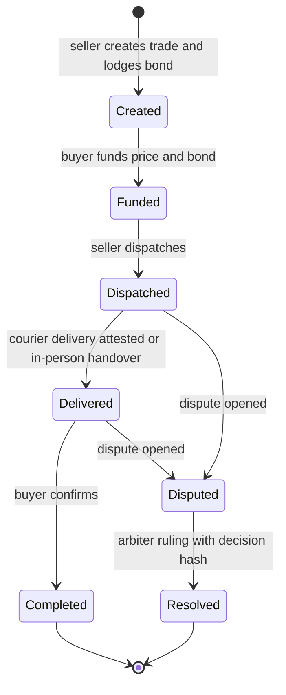

# Pactora

**Every agreement deserves protection.**

Pactora is escrow for social commerce in South Africa. A buyer's money is held safely until the item arrives as promised. Both sides put down a small refundable bond, so cheating costs more than honesty. Users see rand. Settlement happens on Ethereum Sepolia with a USDT-style test token and wallets built on Tether's WDK.

> Everything runs on a test network. 

| | |
|---|---|
| **Live app** | [Link](https://pactora-gray.vercel.app/) |
| **Demo video (under 3 min)** | [Link](https://youtu.be/yEsMGK2-vRw) |
| **Track** | Tether-sponsored |
| **Network** | Ethereum Sepolia (chain ID 11155111) |

## The problem

Millions of deals happen every day on Facebook Marketplace, WhatsApp and Instagram, and they run on blind trust. Buyers pay first and hope the item arrives. Sellers ship first and hope they get paid. When something goes wrong, neither side has recourse.

## The solution

1. **Seller lists a deal** with photos and a price, lodges a small security bond, and shares one link.
2. **Buyer accepts and funds escrow.** New buyers add a small refundable bond. Funds are locked in a smart contract.
3. **Seller ships. Buyer inspects.** If all is well, the buyer confirms and the seller is paid minus a 2% fee. Both bonds are returned.
4. **If something goes wrong,** either side can open a dispute with evidence. An administrator reviews it and records a written, on-chain ruling.

### What makes it different

- **Bonds that remove the incentive to cheat.** Forfeited bonds go to Pactora's treasury, never to the other party, so nobody can profit from a false accusation.
- **Rand-first UX.** Users add funds and cash out in rand (simulated). The token stays behind the scenes.
- **Reputation.** Sellers earn New, Active or Established status from completed deals, distinct buyers and ratings.
- **Everything is auditable.** Every state change is a contract event, and every ruling stores a decision hash.

## Try it as a judge

1. Open the live app and sign up. Email confirmation is off for the demo.
2. On the dashboard, create your wallet (PIN-protected, stored in your browser) and link it to your account.
3. Get a little Sepolia ETH for network fees from any public Sepolia faucet, then claim test tUSDT from the wallet panel or buy some at **Funds**.
4. Use two accounts (two browsers or one private window) to play seller and buyer.
5. Admin features (dispute review, platform overview) need an admin account: `<ADD JUDGE ADMIN LOGIN OR NOTE>`.

## How the escrow works



**Money rules** (example: R1,000 deal, new buyer)

| Item | Amount |
|---|---|
| Pactora fee (on completion only) | 2%, R20 |
| Seller bond | 5%, R50 |
| New-buyer bond (under 3 completed purchases) | 1%, R10 |

**Dispute outcomes:** full refund, partial refund, release to seller, seller misconduct (buyer refunded, seller bond to Pactora), buyer misconduct (seller paid, buyer bond and fee to Pactora).

## Tech stack

| Layer | Tools |
|---|---|
| Smart contracts | Solidity 0.8.24, Foundry, OpenZeppelin |
| Wallets | Tether WDK (`@tetherto/wdk-wallet-evm`), seed encrypted with a PIN in the browser |
| Chain access | viem on Ethereum Sepolia |
| App | Next.js 16 (App Router), TypeScript, Tailwind, shadcn/ui |
| Backend | Supabase (Postgres with row-level security, Auth, Storage) |
| Testing | Foundry (52 contract tests including fuzzing), Vitest |
| Hosting | Vercel |

## Smart contracts

| Contract | Purpose |
|---|---|
| `TestUSDT.sol` | Our own test token (tUSDT, 6 decimals). Faucet and minter-only `mintFor`. Reverts on non-test chains. **Not real Tether USDT.** |
| `PactoraEscrow.sol` | Bonds, funding, delivery, disputes, fee and payouts. |

- Escrow (Sepolia): `0x91D4d1537F104e5Eb09161483BE5313A42931d9B` ([Etherscan](https://sepolia.etherscan.io/address/0x91D4d1537F104e5Eb09161483BE5313A42931d9B))
- tUSDT (Sepolia): `0xA73E913adB5821B36a24dAe6822B58D33808D2f4`

## Security design

- **Server never trusts the browser.** After each on-chain action, the server reads the contract and checks that the on-chain terms equal the terms agreed in the database before updating anything.
- **Money fields cannot be forged.** Prices, bonds and fees are derived by a database trigger, not by the client.
- **Row-level security** on every table. Evidence lives in a private bucket and is served with signed URLs.
- **Wallet seed never leaves the browser.** It is AES-GCM encrypted with the user's PIN.
- **Secrets stay server-side.** The arbiter and service keys are never exposed to the client.
- **Idempotent minting.** Each ramp purchase mints with a unique on-chain reference, so it can never mint twice.

## Run it locally

Prerequisites: Node 20+, [Foundry](https://book.getfoundry.sh), a Supabase project, a Sepolia RPC URL and a testnet-only wallet with Sepolia ETH.

```bash
# 1. Contracts
cd contracts
cp .env.example .env            # add RPC URL, deployer key, treasury address
forge install && forge test     # 52 tests
forge script script/DeployTestUSDT.s.sol --rpc-url $SEPOLIA_RPC_URL --broadcast
forge script script/DeployEscrow.s.sol   --rpc-url $SEPOLIA_RPC_URL --broadcast

# 2. Database: run these in the Supabase SQL Editor, in order
#    supabase/migrations/000_all_tables.sql, 003, 004, 005, 006_ramps.sql, 007_usernames.sql
#    Then make an admin: update profiles set is_admin = true where id = '<user id>';

# 3. Web app
cd ../web
cp .env.example .env.local      # fill in every value
node scripts/check-env.mjs      # validates env vars and shows which wallets your keys control
npm install
npm test
npm run dev
```

## Repository layout

```
contracts/   Solidity contracts, Foundry tests and deploy scripts
supabase/    SQL migrations
web/         Next.js app (pages in src/app, logic in src/lib, UI in src/components)
docs/        Deploy guide, demo script, test checklist, limitations
```

## Honest scope

Pactora is a hackathon MVP. These parts are deliberately simulated or simplified:

- **Courier tracking is simulated.** The seller presses the steps and the arbiter records final delivery on-chain.
- **The ZAR on and off-ramps are simulated.** Rates and fees are fixed demo values, and bank details are fictional.
- **tUSDT is a test token,** not Tether USDT.
- **One administrator acts as arbiter.** There are no appeals, and no identity verification.
- **Wallet custody is demo-grade.**

Full list, including the treasury conflict-of-interest note: [`LIMITATIONS.md`](LIMITATIONS.md).

## Roadmap

1. A local payments partner for real ZAR on and off-ramps, with USDT0 as the settlement asset.
2. Real courier integrations for delivery attestation and auto-release.
3. Independent arbiters and appeals, with a separate bond pool.
4. Identity and phone verification, and the Verified and Restricted seller tiers.
5. Independent security review and legal and regulatory assessment.

## Team

Built by Benhur Mwamba.

